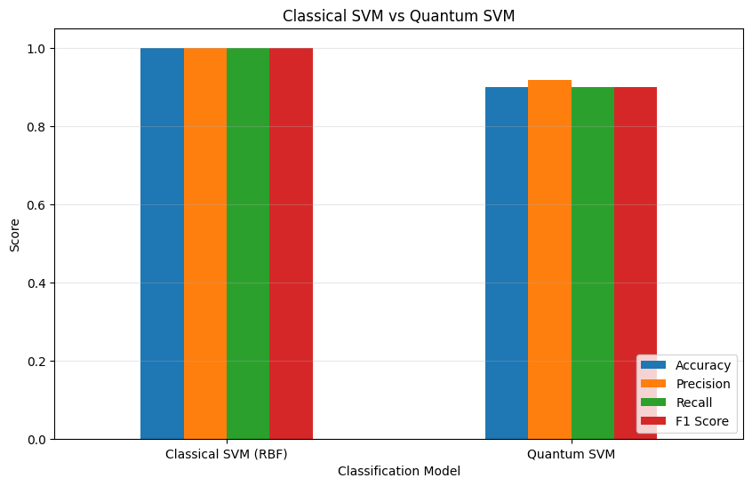

# Quantum vs Classical SVM on the Iris Dataset

Binary classification of Iris *setosa* vs *versicolor* using petal length and petal width, comparing a **classical RBF Support Vector Machine** with a **Quantum Support Vector Machine (QSVM)** built with Qiskit and Qiskit Machine Learning.

[](https://colab.research.google.com/github/<your-username>/qml-iris-classification/blob/main/Quantum_Machine_Learning_Iris_Classification.ipynb)

## What the notebook does
1. Loads the Iris dataset (from scikit-learn) and keeps two classes and two features.
2. Splits the data 80/20 (stratified) and scales features to [0, π] so they can be used as rotation angles.
3. Trains a **classical SVM** (RBF kernel) as the baseline.
4. Encodes the data with a **ZZ feature map** (2 qubits, 2 repetitions, linear entanglement) and builds a **fidelity quantum kernel**.
5. Trains a **QSVC** on that kernel and evaluates it with the same metrics.
6. Compares both models with a table and bar chart.

All quantum computations run on a **classical simulator** (no real quantum hardware, no noise).

## Results (from the saved run, 20 test samples)

| Model | Accuracy | Precision | Recall | F1 |
|---|---|---|---|---|
| Classical SVM (RBF) | 1.00 | 1.000 | 1.00 | 1.000 |
| Quantum SVM | 0.90 | 0.917 | 0.90 | 0.899 |



**Caution:** the test set is tiny (one misclassification = 5 percentage points), the problem is easy, and the quantum model was not tuned. The difference should not be read as evidence that either approach is better. See section 7 of the notebook for discussion and follow-up experiments.

## Repository structure
```
qml-iris-classification/
├── Quantum_Machine_Learning_Iris_Classification.ipynb   # annotated notebook (with saved outputs)
├── figures/                                             # charts exported from the notebook
├── requirements.txt
├── .gitignore
└── README.md
```
No data folder is needed: the dataset ships with scikit-learn.

## How to run

**Option 1: Google Colab.** Open the notebook with the badge above (after pushing to GitHub). The first cells install everything.

**Option 2: locally**
```bash
git clone https://github.com/<your-username>/qml-iris-classification.git
cd qml-iris-classification
python -m venv .venv
source .venv/bin/activate      # Windows: .venv\Scripts\activate
pip install -r requirements.txt
jupyter notebook Quantum_Machine_Learning_Iris_Classification.ipynb
```
Then choose **Kernel → Restart & Run All**. Running the quantum kernel cells can take a little while on a simulator.

## Reproducibility notes
- The train/test split uses `random_state=42`.
- `requirements.txt` lists minimum versions only. For exact reproducibility, run `pip freeze | grep -iE "qiskit|scikit-learn|numpy|pandas|matplotlib|seaborn"` in the environment where the notebook ran (for example Colab) and pin those versions.
- The notebook uses the function `zz_feature_map`, which exists in recent Qiskit releases. Older versions provide the `ZZFeatureMap` class instead.

## Reference
Havlíček, V. et al. *Supervised learning with quantum-enhanced feature spaces.* Nature 567, 209–212 (2019).
